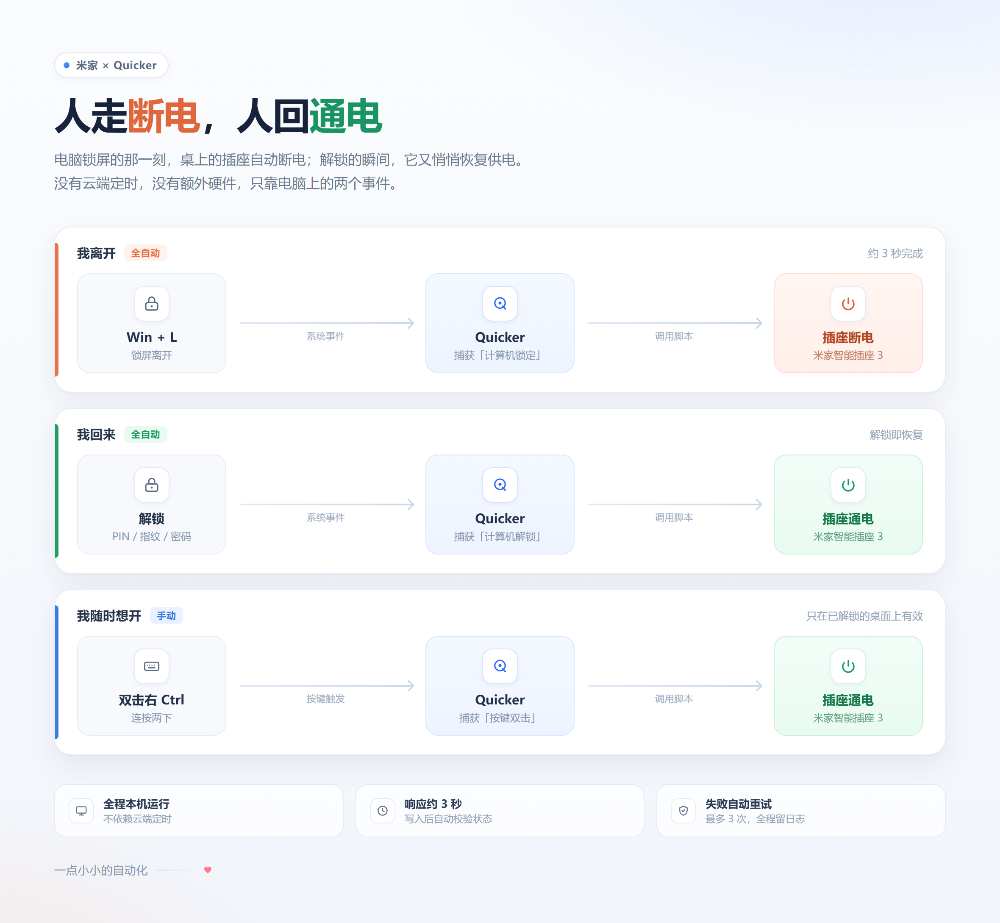
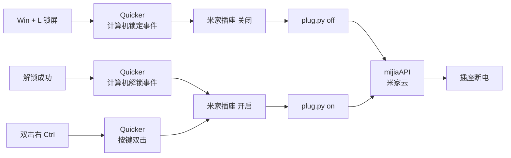

# 米家插座 × Quicker 自动化

> 电脑锁屏，桌上的插座自动断电；解锁回来，它又自动恢复供电。  
> 没有云端定时，没有额外硬件，只靠 Windows 的两个系统事件。
>
> 仓库里还有一个独立的 Quicker 动作：[传输空闲自动清后台](quicker/transfer-idle-watchdog/README.md)。它监控指定软件的上传/下载，连续空闲达到设定时间后结束后台进程；默认针对百度网盘 5 分钟。



## 它做了什么

| 场景 | 触发 | 结果 |
| --- | --- | --- |
| 我离开 | `Win + L` 锁屏 → Quicker「计算机锁定」事件 | 调用 `plug.py off`，插座断电 |
| 我回来 | 解锁（PIN / 指纹 / 密码）→ Quicker「计算机解锁」事件 | 调用 `plug.py on`，插座通电 |
| 我随时想开 | 在已解锁的桌面上双击右 `Ctrl` | 调用 `plug.py on`，插座通电 |

锁屏界面上按键无效，这是 Windows 安全桌面机制决定的；恢复供电靠的是「解锁成功」事件，不需要按键。

## 工作链路



实测一条链路约 3 秒：事件触发 → Python 启动 → 云端写入 → 回读校验。

## 文件结构

```text
.
├─ plug.py                          # 开关控制脚本（on / off / toggle / status）
├─ discover.py                      # 列出账号下的设备，帮助找 DID
├─ config.example.json              # 配置模板
├─ quicker/
│  ├─ 米家插座-开启.operation.json   # Quicker「运行或打开」动作配置
│  ├─ 米家插座-关闭.operation.json
│  ├─ 触发器配置.md                  # 三条触发器的接法
│  └─ transfer-idle-watchdog/        # 独立动作：传输空闲自动清后台
├─ 米家插座自动化示意图.html          # 示意图源文件
└─ 米家插座自动化示意图.png           # 成品图
```

## 前置条件

- Windows 10 / 11
- [Quicker](https://getquicker.net/)（用到「计算机锁定 / 解锁」事件和「按键双击」）
- Python 3.10+（实测 3.12）
- 米家 App 已绑定「米家智能插座 3」
- [MiHome-Windows](https://github.com/huanyuejue/MiHome-Windows)：用于扫码登录，生成 `mijiaAPI` 凭据
- Python 包 `mijiaAPI`

## 快速开始

### 1. 安装依赖

```powershell
python -m pip install mijiaAPI
```

### 2. 登录米家账号

安装并打开 MiHome-Windows，用米家 App 扫码登录。登录成功后凭据会保存在：

```text
%USERPROFILE%\.config\mijia-api\auth.json
```

### 3. 找到插座 DID

```powershell
python discover.py
```

在输出里找型号为 `cuco.plug.v3` 的那一行，记下 DID。
也可以从 `%LOCALAPPDATA%\MiHome-Windows\devices_cache.json` 里查。

### 4. 写配置

把 `config.example.json` 复制为 `config.json`，填入 DID：

```json
{
  "did": "你的设备DID",
  "prop": "on-2",
  "retries": 3
}
```

`on-2` 是米家智能插座 3 的主开关属性（service 2 / property 1）。换别的型号时，属性名可能不同。

### 5. 命令行验证

```powershell
python plug.py status   # 输出 True / False
python plug.py off      # 断电
python plug.py on       # 通电
```

每次执行都会往 `plug.log` 追加一行 `START` 和结果，出问题先看它。

### 6. 在 Quicker 里建两个动作

新建两个「运行或打开」类型的动作：

| 动作名 | 程序 | 参数 | 工作目录 |
| --- | --- | --- | --- |
| 米家插座 开启 | `...\Python312\python.exe` | `"C:\path\to\plug.py" on` | 脚本所在目录 |
| 米家插座 关闭 | `...\Python312\python.exe` | `"C:\path\to\plug.py" off` | 脚本所在目录 |

要点：窗口样式设为**隐藏**，不要勾选「等待程序退出」。可直接参考 `quicker/*.operation.json`。

> 不要用 `pythonw.exe`。`mijiaAPI` 初始化时会调用 `sys.stdout.isatty()`，而 `pythonw` 下 `stdout` 是 `None`，会直接报 `AttributeError`。脚本里虽然做了兜底，但 `python.exe + 隐藏窗口`更稳。

### 7. 挂触发器

| 触发器 | 参数 | 调用动作 |
| --- | --- | --- |
| 事件触发 → 计算机锁定 | — | 米家插座 关闭 |
| 事件触发 → 计算机解锁 | — | 米家插座 开启 |
| 按键双击 | 右 Ctrl（VK 163） | 米家插座 开启 |

新动作如果还在「暂存区」，触发器是找不到它的，需要先**保留到动作库**（放入「全局」场景）。详见 [quicker/触发器配置.md](quicker/触发器配置.md)。

## 另一个动作：传输空闲自动清后台

`quicker/transfer-idle-watchdog/` 与本页的插座联动互相独立，是另一个通用的 Quicker 动作：

- 监控指定软件的上传和下载，连续 N 分钟没有传输后结束后台进程；默认对百度网盘使用 5 分钟。
- 支持多个软件，每个软件可单独设置进程名单、传输筛选、空闲时间与流量阈值。
- 设置界面是一张统一列表：搜索、运行中软件快捷添加、开关、行内编辑。
- 后台监控独立运行，Quicker 启动后可自动恢复；提供运行状态、日志、重启/停止监控菜单。

安装、配置字段和触发器说明见 [动作 README](quicker/transfer-idle-watchdog/README.md)。

## 已验证

2026-10-24 在 Windows 10 + 米家智能插座 3（`cuco.plug.v3`）上实测：

| 链路 | 结果 |
| --- | --- |
| `Win + L` 锁屏 → 关闭插座 | 通过，日志 `[off] OK set False -> verified False` |
| 解锁 → 打开插座 | 通过，日志 `[on] OK set True -> verified True` |
| 双击右 Ctrl → 打开插座 | 通过，父进程为 `Quicker.exe` |
| 写入未生效时自动重试 | 通过，最多 3 次 |

## 排错

**`未配置设备 DID`**  
没有 `config.json`，或 `did` 还是模板里的 `YOUR_DEVICE_DID`。

**`无法导入 mijiaAPI`**  
当前 Python 环境没装包，或 Quicker 里填了另一个 Python 的路径。用 `python -c "import mijiaAPI"` 确认。

**登录失效 / 鉴权失败**  
重新打开 MiHome-Windows 扫码登录，刷新 `auth.json`。

**锁屏后按右 Ctrl 没反应**  
正常。锁屏时 Windows 会切到安全桌面，Quicker 的键盘钩子收不到按键。解锁回桌面后再按。

**触发器没反应**  
先确认动作已经离开「暂存区」进入动作库；再确认 Quicker 正在运行、触发器处于启用状态。可以看 `plug.log` 有没有新的 `START` 行，判断是触发器没响还是脚本没跑。

**第一次写入偶发不生效**  
米家云端偶有延迟。脚本会回读校验，不一致就重试，最多 3 次；日志里会留下 `WARN`。

**插座离线**  
先在米家 App 里确认设备在线。离线时云端写入会失败。

## 安全与边界

- `auth.json` 是米家账号的登录凭据，**明文保存**。不要提交到仓库、不要发人、不要放公共电脑。
- `config.json` 和 `plug.log` 已加入 `.gitignore`，不会被提交。
- 插座控制的是真实市电。第一次测试请接安全负载，不要直接带电脑、硬盘或大功率设备。
- 电脑关机 / 睡眠时，这套自动化不会运行；它不是 7×24 的常驻服务。
- MiHome-Windows 和 mijiaAPI 都是社区项目，米家接口变更后可能失效。失效时 `plug.log` 会连续出现 `FAILED`。

## 版本与更新

当前版本：**v1.0**（米家插座动作，首个公开版本）。`transfer-idle-watchdog` 是后续加入的独立动作，不随此版本号变化，说明见其目录。

- 每个版本的改动记录在 [CHANGELOG.md](CHANGELOG.md)。
- 所有历史版本在 [Tags](https://github.com/woaixaingxaing/quicker-actions/tags) 里，可下载对应版本的完整源码。
- 以后修改按语义化版本递增：修 Bug 用 `v1.0.1`，新增功能用 `v1.1`，有不兼容变更才用 `v2.0`；提交后打标签并推送即可，Git 会保留旧版本。

## 参考

- [mijiaAPI](https://github.com/Do1e/mijia-api)
- [MiHome-Windows](https://github.com/huanyuejue/MiHome-Windows)
- [Quicker](https://getquicker.net/)

这是一个个人自动化项目，按现状提供，使用前请自行确认设备与负载安全。
