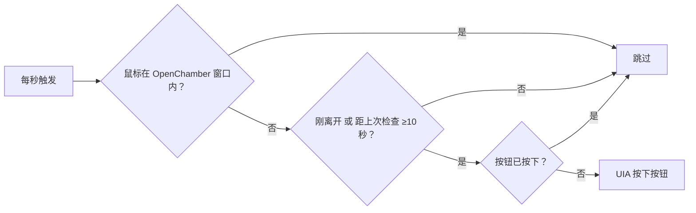

# OpenChamber 工作状态面板常显（Quicker 动作）

> 鼠标一离开 OpenChamber 窗口，右上角的「工作状态」面板就自动打开——TPS、系统负载、用量一直留在屏幕上，方便一边干别的活一边瞄一眼。

OpenChamber 的工作状态面板（会话 / TPS / System / 用量 / MCP / 上下文来源）由右上角那个「面板」图标控制。手滑关掉、换会话后忘了开，屏幕上就看不到运行状态了。这个动作负责：只要鼠标不在 OpenChamber 窗口里，就把面板保持在「已打开」状态。

> [!WARNING]
> **实测有副作用，不推荐日常启用。** 在 Chromium / Electron 应用上，持续的 UI Automation 查询会让内核进入辅助功能模式；本机表现是**输入法状态栏跑到屏幕顶部、不再跟随光标**（停用触发器后恢复，个别情况要重启应用才复位）。因此这个动作只适合「确实需要、并且能接受这个副作用」的场合。

## 更省事的做法（推荐）

实测这个面板是**常开**的：手动点一次右上角的按钮把它打开后，切换会话、切到别的显示器、窗口失焦都不会自动收起（只有再点一次才会关）。所以多数情况下根本不需要自动化——打开一次就够了。

只有在你经常手动关掉它、又希望它自己回来时，才值得启用本动作；一旦发现输入法不跟随光标，先停用触发器。

## 行为

- 触发方式：Quicker「定时重复」事件，每 1 秒检查一次。
- 鼠标在 OpenChamber 窗口内：什么都不做。
- 鼠标离开窗口：立刻检查一次，之后每 10 秒复核一次。
- 检查方式：用 UI Automation 读右上角「切换工作状态面板」按钮的按下状态（`TogglePattern`）。已经按下就跳过；没按下才按。
- 全程不移动鼠标、不抢焦点，不会打断你在其他软件里的操作。
- 只会「保证打开」，不会主动关闭面板。

## 判断流程

## 为什么不用模拟点击

点坐标要先把光标挪过去，会打断手上的操作，窗口一缩放坐标还会失效。直接操作控件的 `TogglePattern`，既不动光标，也不依赖分辨率。

## 安装

需要 Windows 10/11 + Quicker，以及 OpenChamber 桌面版。

1. Quicker 里新建「C# 脚本」动作，引擎 `qkeval`，超时 30 秒（对应 `operation.json`）。
2. 把 `main.cs` 全部内容粘进脚本并保存。
3. 按 `info.yaml` 填标题、描述、图标（可留默认）。
4. **保存后移出「暂存区」**，放进「全局」场景——动作还在暂存区时，事件触发器不会真正执行。
5. 加触发器：事件 → 定时重复，重复间隔 `1` 秒，最大重复次数 `0`（不限）。

## 触发器

| 事件 | 关键参数 |
| --- | --- |
| 定时重复 `Repeat` | 重复间隔 1 秒；最大重复次数 0（不限） |

Quicker 免费版对自定义事件有配额（2 条），装之前先看看有没有别的规则可以合并。

## 已知限制

- 按钮名字取自界面文案：中文「切换工作状态面板」，找不到时回退英文「Toggle work status panel」。换其他语言界面需要改脚本里的这两个字符串。
- 面板只在有会话内容时渲染。新建会话的空白页（「我们今天要做什么？」）看不到面板，这是 OpenChamber 自己的行为，不是脚本没生效。
- 它保证的是「开着」：想彻底收起面板，请先停用这条触发器再手动关，否则 10 秒内又会被打开。
- 每 10 秒做一次 UI Automation 查询；鼠标在窗口内时只做一次轻量的窗口 / 光标判断。

## 实测记录

2026-11-03 本机（Windows，OpenChamber 桌面版，1096×1936 窗口）：手动关闭面板、把鼠标移到另一块屏 → 约 1~4 秒后面板自动出现，并在鼠标持续离开、窗口未聚焦的情况下保持显示。
