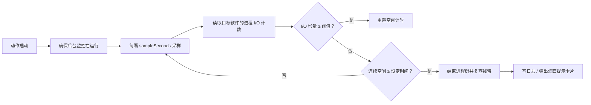

# 传输空闲自动清后台（Quicker 动作）

> 给指定软件加一个「闲置倒计时」：连续 N 分钟没有上传或下载，就结束后台进程，把内存和句柄还回来。下次要用时重新打开即可。

默认规则针对**百度网盘**：连续 5 分钟无传输，结束后台进程。可以添加任意软件，每个软件单独设置进程、传输筛选、空闲时间与流量阈值。

## 功能

- 一个软件一行，统一列表展示；支持搜索、启用/停用、行内编辑和删除。
- 自动列出当前有窗口的软件，点一下加入列表，不用手输进程名。
- 上传和下载都算活动；两个方向都停了才进入空闲计时。
- 后台监控由独立的隐藏 PowerShell 进程执行，动作窗口关掉不影响计时。
- 配置改完立即生效，监控每次采样都会重新读取 `apps.json`，不需要重启。
- 结束后台进程树，并再次检查残留；Windows 目录下的进程、Quicker 自身和常见系统进程受保护。
- 清理真正结束（或有残留）进程后，屏幕右下角弹出桌面提示卡片，8 秒自动消失，点卡片或按 Esc 可提前关闭；提示由独立小进程显示，不阻塞监控采样。
- 提供「运行状态」「查看日志」「重启/停止监控」右键菜单，排错不靠猜。
- 支持 Quicker 启动时自动恢复监控；监控异常退出后，下次动作触发会补启动。

## 界面

设置窗口是一张软件列表：

- 顶部是搜索框和「添加运行中的软件」。
- 正在运行的软件以胶囊按钮横向排列，点一下就能加入。
- 每行显示软件名、运行状态、监控进程、空闲时间、传输筛选和阈值；右侧是开关与操作按钮。
- 点行主体展开编辑区，可以改软件名、空闲分钟数、流量阈值、进程列表、传输进程和命令行筛选。
- 底部提示保存行为；「保存并关闭」后规则立即交给后台监控。

## 它怎么判断「空闲」



传输量取的是进程 I/O 读写计数（`ReadTransferCount` / `WriteTransferCount`）的增量，不是网卡层的纯网络流量。因此：

- 网盘写缓存、做校验等磁盘活动也会被算作「有活动」，这是偏保守的设计。
- 想只盯真正的传输进程，就填 `transferProcesses`；百度网盘默认只盯 `baidunetdiskhost`，并用 `transferCommandLine: kernel.dll` 进一步筛选。
- 阈值不是累计总量，而是单次采样窗口内的增量；低于阈值的涓涓细流可能被判定为空闲。

## 安装

需要 Windows 10/11、Quicker，以及 PowerShell 5.1（Windows 自带）。

`main.cs` 已经把后台脚本和设置界面源码一起打包进去了，**运行这个动作只需要 `main.cs`**。

1. 在 Quicker 新建一个「C# 脚本」动作，脚本引擎选 `qkeval`，超时设为**不限制**（对应 `operation.json` 里的 `timeoutMs: 0`）。
2. 把本目录 `main.cs` 的全部内容粘贴进动作脚本并保存。
3. 按 `info.yaml` 填写标题、描述和图标（可选）。
4. 运行一次动作，设置窗口会打开；添加软件、设置规则后「保存并关闭」。
5. 需要开机后自动恢复监控时，给动作加一个「Quicker 启动」自动运行触发器，或加一个 15 分钟定时触发器兜底。

如果要改源码：编辑 `settings.tsx`、`watchdog.ps1` 或 `notify.ps1` 后运行

```powershell
python build_action.py
```

会重新生成 `main.cs`（两个 `.ps1` 写入时自动补 UTF-8 BOM），动作下次运行会按 `watchdog.version` 标记自动更新数据目录里的脚本并重启监控，再把新的 `main.cs` 贴回动作即可。

## 触发器

动作对触发来源有区分：

| 触发方式 | 行为 |
| --- | --- |
| 手动运行 / 快捷键 | 先打开设置窗口，关闭后再确保监控在跑（不让启动等待拖慢弹窗） |
| 「Quicker 启动」自动运行 | 只确保监控在跑，不弹窗 |
| 进程启动、定时器等事件触发 | 只确保监控在跑，不弹窗 |

后台监控是全局的，不需要给每个软件单独挂触发器。推荐至少加「Quicker 启动」自动运行，否则 Quicker 重启后没人拉起监控。加一个 15 分钟定时器可以在监控意外退出时自动补上；免费版 Quicker 对事件触发器和自动运行数量有限制，按需取舍。

## 配置

动作首次运行会在动作数据目录生成 `apps.json`。Windows 下位于：

```text
%LOCALAPPDATA%\Quicker\action-data\<动作 ID>\
```

也可以从右键菜单「打开数据文件夹」直接进入。参考 [apps.example.json](apps.example.json)。

| 字段 | 说明 |
| --- | --- |
| `version` | 配置版本，当前为 `1` |
| `sampleSeconds` | 采样间隔，5–120 秒，默认 `10`；只能改 JSON，界面未暴露 |
| `notifications` | 清理后是否弹出桌面提示卡片（仅在确实结束或残留了进程时提示） |
| `apps[].name` | 显示名称 |
| `apps[].enabled` | 是否启用该条规则 |
| `apps[].processes` | 要结束时结束的进程名数组（不带 `.exe`） |
| `apps[].transferProcesses` | 只统计这些进程的 I/O；留空表示统计该软件的全部进程 |
| `apps[].transferCommandLine` | 可选。只统计命令行包含此字符串的传输进程，适合一个进程里跑多种任务的软件 |
| `apps[].idleMinutes` | 连续空闲多少分钟后清理，0.1–1440，默认 `5` |
| `apps[].thresholdKB` | 单次采样窗口内的 I/O 增量阈值（KB），1–1048576，默认 `32` |

`apps.json`、`status.json`、`watchdog.log`、`stop.flag` 都在同一个数据目录里。`watchdog.log` 每次清理会留下耗时、结束数量和残留情况。

## 文件

| 文件 | 作用 |
| --- | --- |
| `main.cs` | 动作主体：设置界面 + 监控生命周期管理（已内嵌下方三个资源） |
| `settings.tsx` | 设置界面的 React/TSX 源码 |
| `watchdog.ps1` | 独立运行的 PowerShell 监控脚本 |
| `notify.ps1` | 清理后弹出的桌面提示卡片（WinForms，独立进程显示） |
| `build_action.py` | 把 `watchdog.ps1`、`notify.ps1`、`settings.tsx` 以 base64 嵌入 `main.cs` |
| `info.yaml` | Quicker 动作标题、描述、图标 |
| `operation.json` | 动作类型与脚本引擎声明 |
| `apps.example.json` | 去敏后的配置示例（仅默认百度网盘规则） |

## 已验证

2026-10-25，Windows 10 + Quicker + PowerShell 5.1：

- 用复制自 `ping.exe` 的受控测试进程验证空闲计时与清理：设 6 秒空闲、5 秒采样，达到阈值后结束 1 个进程，复查剩余 0；受保护的 `conhost` 被跳过。
- 验证配置热更新：修改 `apps.json` 后无需重启监控即按新规则运行。
- 端到端验证桌面提示卡片（v1.0.3）：受控测试进程被清理后，屏幕右下角自动弹出 WPF 提示卡片（抗锯齿圆角 + 阴影），8 秒自动消失；提示期间监控状态持续按 10 秒采样更新，确认不阻塞监控循环。

真实网盘的空闲清理建议先观察一次 `watchdog.log`：不同版本的百度网盘可能更换进程名或传输模块，必要时在设置里调整 `processes` 与 `transferProcesses`。客户端版本变化后，默认规则不保证永远命中。

## 限制与注意

- 这是按进程 I/O 判断，不是抓包；别的磁盘活动可能让计时被重置，低速率传输也可能被当成空闲。
- 清理会关闭整个进程树，正在进行的传输会中断。第一次请用安全的测试进程验证，不要把阈值和空闲时间设得太激进。
- 电脑关机或睡眠时监控不运行；唤醒后若检测到长时间采样间隔，会重置计时，避免一醒来就误杀。
- 监控依赖 Quicker 存活；Quicker 退出后约 10 秒监控自行结束。用自动运行触发器恢复。
- 提权进程可能无法结束，日志里会记为「剩余」；Windows 目录、Quicker 自身和常见系统进程不会被结束。
- 这是一个个人自动化项目，按现状提供。使用前请自行确认要结束的软件与数据安全。
